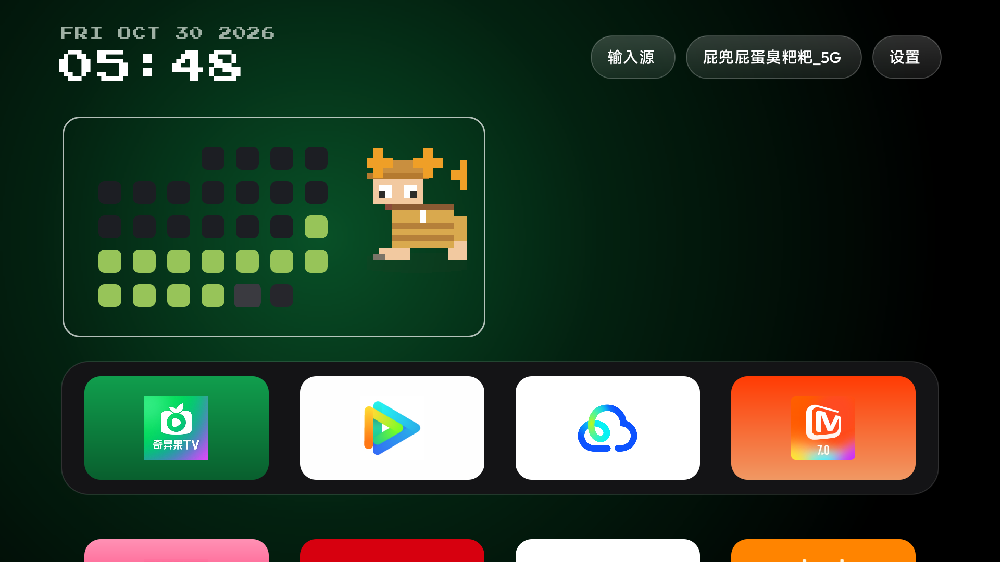

# cleanyourtv-mitv-hyperos3

> 小米电视（澎湃 / HyperOS TV 3）上的 CleanYourTV 定制分支：一套**减肥打卡桌面** + 一份**澎湃 3.0 设备适配记录**。
> 上游 [CleanYourTV](https://github.com/Gathin/cleanyourtv)（MIT，© 2026 Gathin）的 fork，保留全部上游功能，本分支只叠加两层东西。



---

## ⚠️ 先读这一段

- **桌面定制部分**（打卡表、体重页、像素小人）只是普通的 Android 应用代码，编译安装即可，风险为零。
- **设备改动部分**（`device/xiaomi-mitv-mftr0/`，停用系统应用、接管 HOME）会改变电视的系统状态：
  - 全部操作走 **ADB 停用（disable）而非卸载**，可一键恢复；
  - 停用 `com.xiaomi.mitv.upgrade` 后**收不到官方 OTA 固件更新**，需要时重新启用即可；
  - 接管 HOME 后原桌面 PatchWall 仍在（仅停用），随时可切回；
  - 每台电视的固件、包名、白名单都不同，**本仓库的清单只在 MiTV-MFTR0（freeguy，OS3.0.107.0.UFTMATV，Android 14）上实测过**，其他机型请先比对 `device/xiaomi-mitv-mftr0/inventory/` 里的快照再动手。
- 仓库里的设备快照已脱敏：`android_id`、蓝牙 MAC、小米账号 ID 均替换为 `<redacted>`。

---

## 这个仓库里有什么

### 一、桌面定制（本分支新增，上游没有）

| 功能 | 说明 | 文档 |
| --- | --- | --- |
| 坚持墙打卡表 | 从起始日到今天每天一格；**双击左键**打卡/撤销，单击不做事（防误触） | [docs/habit-panel.md](docs/habit-panel.md) |
| 体重页 | 打卡页按**右键**进入：起始 / 当前 / 目标 + 已打卡天数 + 等级 | [docs/habit-panel.md](docs/habit-panel.md) |
| 像素小人 | 16×26 网格的像素小人，形态跟着时钟走，体形跟着体重走 | [docs/pixel-figure.md](docs/pixel-figure.md) |
| 举杠铃动画 | 14:00–16:00 时段：B 腹前提起 → A 过顶举起，500 ms 一帧循环成一次完整举重 | [docs/pixel-figure.md](docs/pixel-figure.md) |
| 像素时钟 | Press Start 2P 点阵字体的时间 / 日期区 | [docs/habit-panel.md](docs/habit-panel.md) |
| 图标美化 | 图标底板取图标边缘色、主体过小自动放大、网格常显应用名、Dock 纯图标 | [docs/mitv-hyperos3.md](docs/mitv-hyperos3.md) |


### 二、澎湃 3.0 设备适配（记录 + 脚本）

| 内容 | 说明 |
| --- | --- |
| HOME 白名单绕过 | CN 固件拒绝 `com.gathin.tvhome` 接管 HOME，改用 `-PlauncherApplicationId=com.ts.launcher` 构建 |
| 停用清单 | 24 个遥测 / 广告 / 预装包 + 系统更新，附停用前后的包名快照 |
| 小米应用商店入口壳 | `launcher/shortcut`（`com.local.shortcut`）给没有 LEANBACK 入口的商店补桌面磁贴 |
| 直播源实测 | 57 个候选地址实测，只 11 个能抓到播放列表 → [docs/live-sources.md](docs/live-sources.md) |
| Netflix 兼容性诊断 | 结论：这台电视无 Widevine CDM，装不了也用不了 → [docs/netflix-compat-check.md](docs/netflix-compat-check.md) |
| 快照与恢复脚本 | [device/xiaomi-mitv-mftr0/](device/xiaomi-mitv-mftr0/) |

---

## 快速开始（只想装桌面）

```bash
git clone <本仓库地址> && cd cleanyourtv-mitv-hyperos3

# 1. 告诉 Gradle 你的 SDK 在哪（换成你自己的路径）
echo "sdk.dir=C:/Path/To/android-sdk" > launcher/local.properties

# 2. 构建（JDK 17 + Android SDK 34）
cd launcher
./gradlew assembleRelease                                          # 标准包名 com.gathin.tvhome
./gradlew assembleRelease -PlauncherApplicationId=com.ts.launcher  # 小米 CN 固件必须用这个身份

# 3. 装到电视（电视需先开 ADB 调试：设置 → 账号与安全 → ADB 调试）
adb connect <电视IP>:5555
adb install -r app/build/outputs/apk/release/app-release.apk
```

> **小米 CN 固件必读**：标准包名 `com.gathin.tvhome` 不在固件 HOME 白名单里，`set-home-activity` 会报 Success 但实际不生效（FallbackHome 接管）。必须用上面的 `-PlauncherApplicationId=com.ts.launcher` 构建，组件名仍是 `com.gathin.tvhome/.MainActivity`。

装完后设为默认桌面：

```bash
adb shell cmd package set-home-activity com.ts.launcher/com.gathin.tvhome.MainActivity
```

---

## 遥控器怎么用

| 位置 | 按键 | 效果 |
| --- | --- | --- |
| 打卡页 | **左键连按两下**（800 ms 内） | 今天打卡 / 再按两下撤销 |
| 打卡页 | **右键** | 进入体重页 |
| 打卡页 | **左键单击** | 不做事（防方向盘误触） |
| 体重页 | **左键** | 返回打卡页 |
| 体重页 | **下键** → **OK** → 上下键 → **OK** | 选中体重框 → 开始编辑 → 调 0.1 kg → 保存记录 |
| 任意磁贴 | **上键** | 焦点回到打卡面板 |

体重框未进入编辑态时，上下键只做正常导航，**不会误改数值**。

---

## 目录结构

```
cleanyourtv-mitv-hyperos3/
├── launcher/                 桌面源码（上游全量 + 本分支定制）
│   ├── app/src/main/java/com/gathin/tvhome/
│   │   ├── HabitPanel.java      打卡表 + 体重页（本分支新增）
│   │   ├── HabitCalendar.java   打卡数据存储（本分支新增）
│   │   ├── PixelBodyView.java   像素小人（本分支新增）
│   │   └── MainActivity.java    接入面板 + 焦点/显隐规则（上游基础上改）
│   └── shortcut/             小米应用商店入口壳 com.local.shortcut（本分支新增）
├── device/xiaomi-mitv-mftr0/ 澎湃 3.0 设备改动：停用清单、快照、恢复说明
├── docs/                     定制文档 + 上游文档（docs/upstream/）
├── tools/                    验证与效果图脚本（含 tv_check.py 真机自动巡检）
└── addons/ themes/ examples/ tests/   上游自带
```

本分支改动的上游文件主要有：`MainActivity.java`、`AppAdapter.java`、`activity_main.xml`、`config.xml`、`strings.xml`、`item_app.xml`，以及新增的 `HabitPanel.java`、`HabitCalendar.java`、`PixelBodyView.java` 和 `shortcut/` 模块。

---

## 配置（改这些就能调）

全部在 `launcher/app/src/main/res/values/config.xml`：

| 键 | 作用 |
| --- | --- |
| `habit_calendar` | 打卡面板开关 |
| `habit_start` | 挑战起始日，如 `2026-10-18` |
| `habit_seed` | 历史补录（逗号分隔日期）；电视无 root 时用种子写入 |
| `habit_weight_page` | 体重页开关 |
| `habit_weight_steps` | 体形分档的体重刻度，如 `80,77,74,71,68,65` |
| `habit_weight_seed` | 历史体重，格式 `2026-10-19=80.0,2026-10-21=79.2` |
| `habit_weight_step` | 录入步长（kg），默认 `0.1` |
| `dock_apps` | Dock 上的应用包名 |

运行期改配置（不用重装）：把 `{"uniform_tiles":true,"tile_menu":true}` 之类的配置推到
`/sdcard/Android/data/<包名>/files/config.json`，见上游 [docs/modules.md](docs/modules.md) 与 `themes/` 目录。

---

## 文档索引

- [docs/habit-panel.md](docs/habit-panel.md) — 打卡表与体重页：交互、数据、配置、显隐规则
- [docs/pixel-figure.md](docs/pixel-figure.md) — 像素小人：三形态时间表、举杠铃动画、绘制原理
- [docs/mitv-hyperos3.md](docs/mitv-hyperos3.md) — 澎湃 3.0 适配要点与踩坑
- [device/xiaomi-mitv-mftr0/](device/xiaomi-mitv-mftr0/) — 设备操作手册 + 停用清单 + 快照
- [docs/live-sources.md](docs/live-sources.md)、[docs/netflix-compat-check.md](docs/netflix-compat-check.md) — 两份实测结论
- [docs/upstream/](docs/upstream/) — 上游 CleanYourTV 原始文档

---

## 致谢与许可

- 上游 [CleanYourTV](https://github.com/Gathin/cleanyourtv)，MIT © 2026 Gathin —— 本仓库保留了上游全部源码与文档，桌面的一切能力都建立在它之上。
- Press Start 2P 字体（SIL Open Font License 1.1），见 `launcher/FONT-LICENSE-OFL.txt`。
- 本分支改动同样以 MIT 发布，见 [LICENSE](LICENSE) 与 [NOTICE](NOTICE.md)。
- 设备改动记录来自一台真实的小米电视（MiTV-MFTR0），所有快照已脱敏；**照抄前请先对照你自己的机型**。
