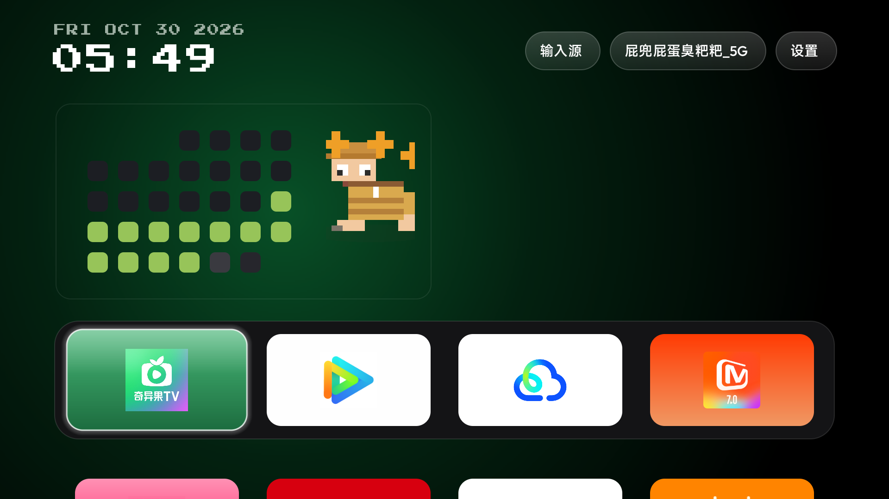
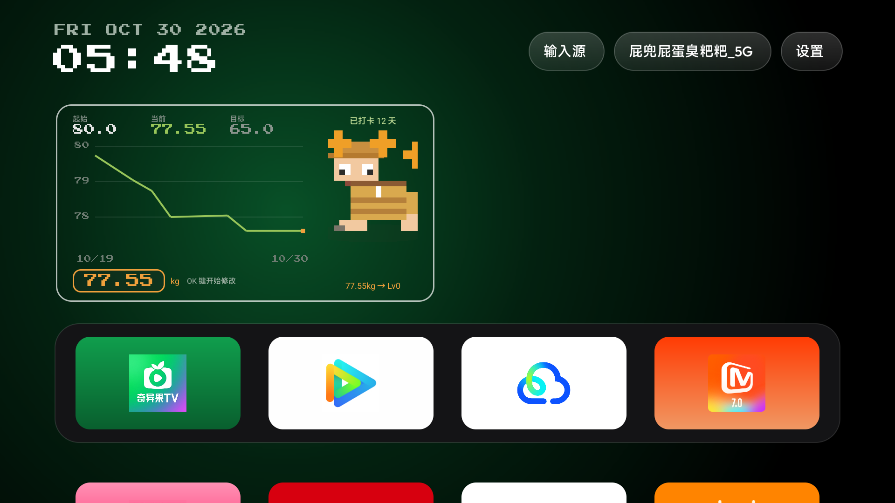

# 打卡表与体重页

桌面左侧悬浮的一块面板：左边是"坚持墙"点阵（一天一格），右边是像素小人；按右键翻到体重页。
代码在 `launcher/app/src/main/java/com/gathin/tvhome/HabitPanel.java`，
数据在 `HabitCalendar.java`，配置在 `res/values/config.xml`。





## 面板长什么样

- **左栏点阵**：从 `habit_start` 到今天，每天一格，7 列，最多 6 行 42 天。
  也可以在整月模式（月首按周一对齐，长月份自动 6 行）与区间模式间切换（左/右键，
  事件在面板内消费，不会移动焦点）。
- **颜色**：已打卡 `#97C459`（绿）、漏打 `#3A3A40`、今天 `#E8912D`、未来 `#26262C`、
  起始日之前 `#1C1E23`。
- **格子**：22 dp，间距 11 dp（半格），正方形。面板宽 406 dp，上间隙 30 dp、下间隙 33 dp。
- **右栏**：像素小人，形态跟时钟、体形跟体重，见 [docs/pixel-figure.md](pixel-figure.md)。
- 面板**没有任何文字标题/统计行**（只有格子和小人），统计信息都在体重页。

## 交互（遥控器）

| 位置 | 按键 | 行为 |
| --- | --- | --- |
| 打卡页 | 左键 ×2（800 ms 内） | 今天打卡 / 再按两下撤销 |
| 打卡页 | 左键 ×1 | 什么都不做（防方向盘误触） |
| 打卡页 | 右键 | 进入体重页 |
| 体重页 | 左键 | 返回打卡页 |
| 体重页 | 右键 | 吞掉，不做事 |
| 体重页 | 下键 | 选中体重输入框（显示「OK 键开始修改」） |
| 体重页 | OK（选中态） | 进入编辑：框体高亮，提示变「上下键 0.1 kg / OK 键保存记录」 |
| 体重页 | 上下键（编辑态） | ±0.1 kg |
| 体重页 | OK（编辑态） | 保存记录，退出编辑态 |

**为什么打卡要双击**：遥控器方向盘很容易误碰，单击左键原本会误打卡。
未进入编辑态时上下键只做正常导航，不会改数值 —— 体重录入必须显式走"选中 → 编辑 → 保存"三步。

## 体重页显示什么

- 起始（`habit_weight_steps` 第一个值）/ 当前（最新一条记录）/ 目标（最后一个值）
- 已打卡天数（streak 之外的总天数）、体形等级 `77.55kg → Lv0`
- 三档字号统一为 12 sp

## 数据存哪、怎么补录

- 打卡记录和体重都存 **SharedPreferences**（`HabitCalendar`），只存在电视本地，
  卸载应用会丢 —— 想留底就改 `config.xml` 里的种子后重装。
- 电视**没有 root**（`adbd cannot run as root in production builds`），不能直接写
  `shared_prefs`，所以历史数据用种子补录：`MainActivity` 在 `setup()` 前调用
  `HabitCalendar.seed()`，把 `habit_seed` / `habit_weight_seed` 里的日期一次性并入，
  之后可以在面板上撤销。

## 配置一览（`res/values/config.xml`）

| 键 | 示例 | 说明 |
| --- | --- | --- |
| `habit_calendar` | `true` | 面板总开关，也可用主题 `config.json` 的 `habit_calendar` 关掉 |
| `habit_start` | `2026-10-18` | 挑战起始日 |
| `habit_seed` | `2026-10-18,2026-10-19,...` | 历史打卡补录 |
| `habit_weight_page` | `true` | 体重页开关 |
| `habit_weight_steps` | `80,77,74,71,68,65` | 体形分档刻度（同时给出起始/目标） |
| `habit_weight_seed` | `2026-10-19=80.0,2026-10-21=79.2` | 历史体重补录 |
| `habit_weight_step` | `0.1` | 录入步长（kg） |

## 显隐规则（向下浏览应用时面板不挡路）

- 判定方式：**焦点一落位就按行决定**，不等滚动结束 —— Dock 那一行显示，其余行立即淡出
  （隐藏 110 ms / 恢复 160 ms）；滚动过程中另有几何重叠检测兜底。
- 面板自身获得焦点时**必定完整显示**。
- 绘制层级：面板在 `activity_main.xml` 里排在应用容器（grid + dock）**之前**，
  所以磁贴滚上来时是磁贴盖住面板，而不是面板浮在应用上。

实测（1920×1080）：Dock 焦点时面板区域绿格像素 21504 = 完整显示；下移一行后 28 = 已隐藏；
退回 Dock 恢复 21504。

## 验证脚本

```bash
export TV_HOST=<电视IP>:5555
python tools/tv_check.py shot check down down    # 按几次键再截图，打印绿格数与焦点
python tools/tv_check.py run                     # 走一遍：起始 → 逐行下移
```

`tools/panel_visible.py` 的 `count_green()` 数面板区域的绿色像素判定显隐，
`tv_check.py` 负责 ADB 自动重连、按键、截图、读焦点与文本。

## 踩过的坑

- 面板曾排在根布局最后（最上层），透明淡出看似生效其实被磁贴盖住 —— 必须靠层级顺序而不是 alpha。
- 调试期一次崩溃把电视的**默认桌面设置清空**了，用下面的命令恢复：

  ```bash
  adb shell cmd package set-home-activity com.ts.launcher/com.gathin.tvhome.MainActivity
  ```
- `grid.getViewTreeObserver()` 写在 `grid` 赋值之前会导致 `onCreate` 空指针崩溃，
  症状同样是"回落到系统设置页"。
