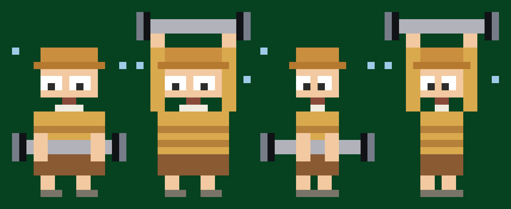
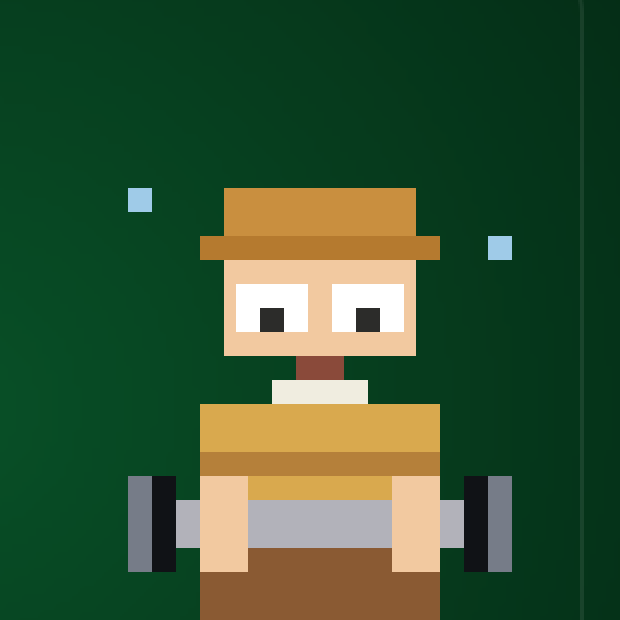
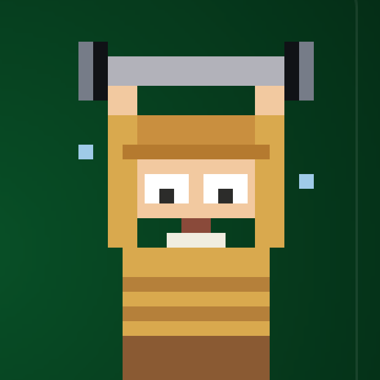

# 像素小人

面板右边那个小人：`launcher/app/src/main/java/com/gathin/tvhome/PixelBodyView.java`。
**不是位图**，而是一个 16×26 的网格，全部用轴对齐的矩形画出来，所以一套代码覆盖所有形态，
什么都不用打包进 APK。

## 形态跟着时钟走

| 时段 | 形态 | 说明 |
| --- | --- | --- |
| **23:00 – 08:00** | 饿死了 | 抱膝坐地、双眼成叉、张嘴、肚子旁两道蓝色"咕咕"波纹 |
| **08:00 – 23:00** | 站立 | 逐行绘制，棕色条纹贯通躯干和双袖 |
| **14:00 – 16:00** | 举杠铃 | B 腹前提起 → A 过顶举起，500 ms 一帧循环 |

常量在 `HabitPanel`：`HUNGRY_FROM=23`、`HUNGRY_TO=8`、`RUN_FROM=14`、`RUN_TO=16`。
面板每分钟刷新一次，到点自动切换形态，不用重启。


## 举杠铃动画

两帧共用同一套身体几何，**只有杠铃和手臂移动**，所以切换时身体不跳动：

- **B 腹前提起**：杠在腹前（第 18–19 行），手从躯干轮廓内侧握住杆（第 17–20 行）。
- **A 过顶举起**：杠在头顶上方（第 1–2 行），手臂沿头两侧竖直上举，手在杠正下方（第 3–4 行）。
- 身体统一：头 5–11 行、躯干 14–19 行、短裤 20–22 行、腿 23–25 行。



TV 实拍：

| B 腹前提起 | A 过顶举起 |
| --- | --- |
|  |  |

**为什么选举杠铃而不是跑步**：全是轴对齐矩形（杆是横条、片是竖块），没有斜线圆弧；
单帧就能读懂；杠铃横跨 14/16 格把画面撑满，电视远看也清楚。

**绘制顺序**：身体 → 杠铃与杠铃片（这样杆压在肚子前面）→ 手（盖在杆上，读作"握住"）。

**杠铃片**：主体近黑 `#101216`，外沿亮灰 `#767C88`，读作两片叠放；
以杠杆为轴**上下严格对称**（过顶帧片占第 0–3 行、杆占 1–2 行；腹前帧片 17–20、杆 18–19）。
杆是 `#B2B2BA`。

## 体形跟着体重走

五档，从圆到瘦，`LEVELS` 三个数是「躯干宽 / 腿间距 / 脸宽」：

```java
{10, 3, 8},  {9, 3, 8},  {8, 2, 7},  {7, 2, 6},  {6, 1, 6}
```

宽度按最新体重从 `habit_weight_steps` 算出来，**不缓存** —— 长时间不记录体重，
等级就按当前值重算（长胖了会变圆）。

坐姿是唯一例外：它是整张 16×26 字符地图（`SITTING`）逐格画的，宽度固定，
不为的是让手臂和膝盖的位置始终可读。

## 两个可以复用的小工具

```bash
python tools/preview_lift.py      # 直接在控制台画出两帧的字符地图 + preview-lift.png
python tools/gen_faint_mock.py    # 坐姿小人的候选效果图
python tools/gen_lift_mock.py     # 举杠铃三候选（A 过顶 / B 腹前 / C 扛肩深蹲）
```

`preview_lift.py` 复制了 `PixelBodyView` 的数学与绘制顺序，改代码前先在 Python 里看版式，
省掉一次 1 分半的编译。它按 Skia 的规则判断一个格子是否被填中
（`x <= col + 0.5 < x + w`），否则 0.5 偏移的位置（比如两只眼睛的间距）会算错。

## 踩过的坑

- **`geom()` 索引越界**：早前重构去掉"肚子"参数后数组只剩 9 个元素，
  `drawStanding` 还在读 `g[9]`，结果**站立姿态一画就崩溃黑屏**。
  因为之前所有测试都恰好落在饿死/跑步时段，这个 bug 一直没暴露，
  直到逐时段验证时 8 点整黑屏才现形。已修正为 `tx=g[3] fx=g[4] ax=g[5] bx=g[6] lx=g[7] rx=g[8]`。
- **验证不同时段**：电视 shell 无权改系统时间，别用 `date -s`。
  临时构建里读 `SystemProperties("debug.posehour")` 覆盖小时值即可逐时段截图，测完记得移除。
- **星星别贴帽檐**：原来旋转星星紧贴帽檐，读起来像一对鹿角，后来彻底移开了。
